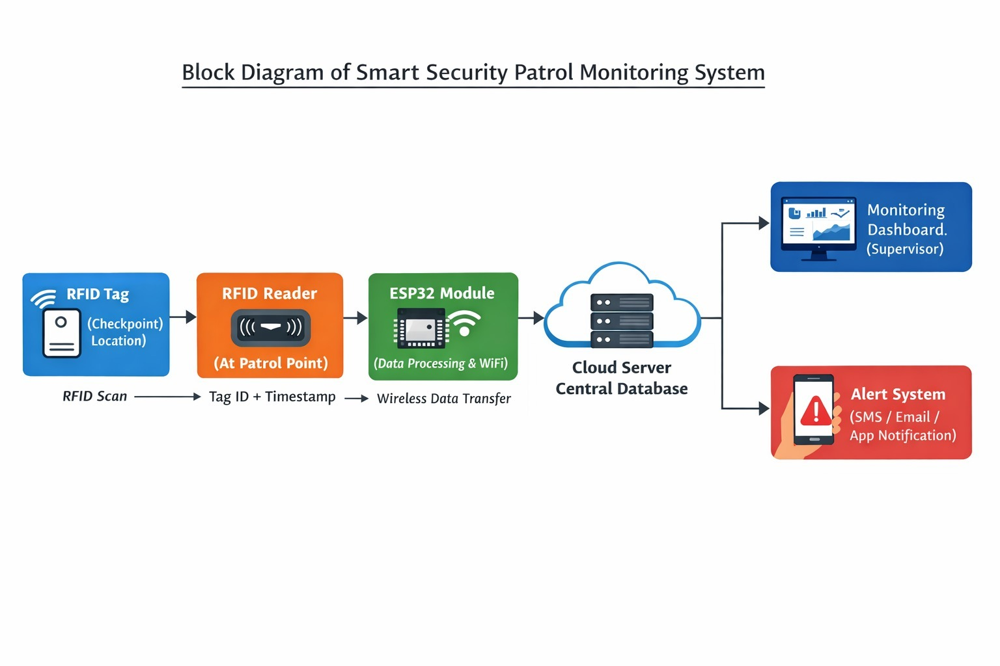
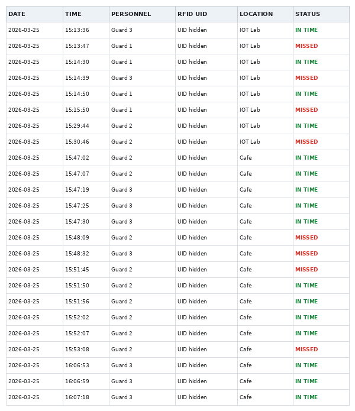
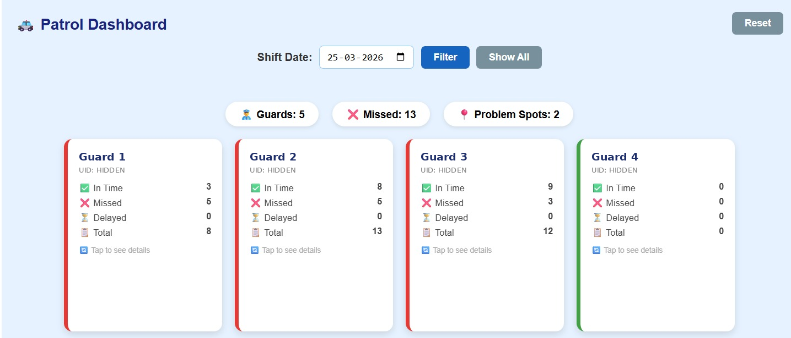
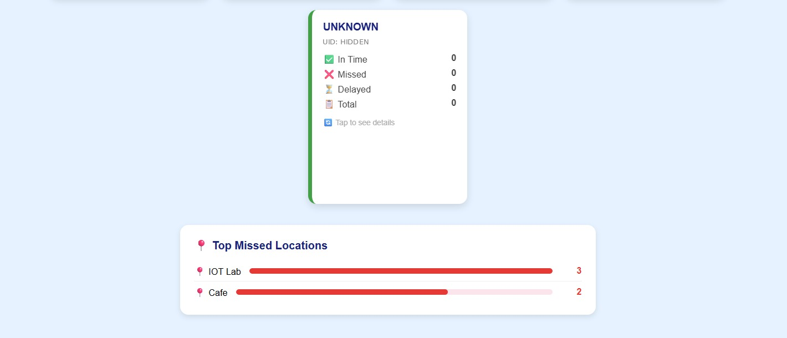
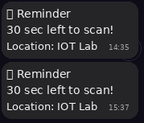
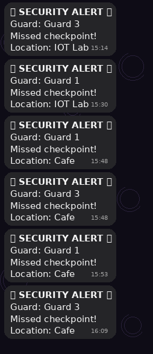

# 🛡️ IoT-Based Smart Security Patrol Monitoring System

An ESP32-based IoT security patrol monitoring system that automates security personnel identification, checkpoint monitoring, patrol data logging, and alert notifications using RFID, Google Apps Script, Google Sheets, and the Telegram Bot API.

Security managers can monitor patrol activity from a centralized dashboard, track missed checkpoints, and receive automated alerts, while security personnel receive timely reminders to complete their scheduled scans.

---

## 📑 Table of Contents

1. [Project Overview](#-1-project-overview)
2. [Project Objectives](#-2-project-objectives)
3. [Hardware Components](#️-3-hardware-components)
4. [Software and Technologies](#-4-software-and-technologies)
5. [System Architecture](#️-5-system-architecture)
6. [Working Principle](#-6-working-principle)
7. [Google Apps Script and Google Sheets Integration](#️-7-google-apps-script-and-google-sheets-integration)
8. [Google Sheets Dashboard](#-8-google-sheets-dashboard)
9. [Telegram Notification System](#-9-telegram-notification-system)
10. [Key Features](#-10-key-features)
11. [Installation and Configuration](#-11-installation-and-configuration) 
12. [Limitations](#️-13-limitations)
13. [Troubleshooting](#-14-troubleshooting)
14. [Applications](#-15-applications)
15. [Future Enhancements](#-16-future-enhancements)
16. [Project Outcome](#-17-project-outcome)
17. [License and Author](#-18-license-and-author)

---

## 📌 1. Project Overview

Traditional security patrol monitoring relies on manual attendance registers and physical supervision, which makes it hard to verify that personnel actually visited their assigned checkpoints on time.

This project addresses that with an **IoT-Based Smart Security Patrol Monitoring System** built on an ESP32 and RFID technology.

Each security staff member is assigned an RFID card with a unique ID. When the card is scanned at a checkpoint, the ESP32 identifies the person and processes the patrol information.

The data is sent over Wi-Fi to Google Apps Script and stored in Google Sheets. A Google Sheets dashboard gives a centralized view of patrol activity, personnel-wise statistics, missed patrol counts, and problematic locations.

Telegram Bot API provides two types of automated notifications:

- **Security Staff:** reminders to complete scheduled checkpoint scans.
- **Security Manager:** alerts when a scheduled checkpoint is missed.

---

## 🎯 2. Project Objectives

- Automate security patrol monitoring using RFID technology.
- Identify security personnel using unique RFID card IDs.
- Monitor checkpoint scanning activity.
- Maintain digital records of patrols in Google Sheets.
- Automate patrol reminders for security staff.
- Notify the security manager about missed checkpoints.
- Provide a dashboard for personnel-wise and location-wise monitoring.
- Reduce dependency on manual registers and continuous supervision.

---

## ⚙️ 3. Hardware Components

| Component | Purpose |
|---|---|
| ESP32 Development Board | Main controller for RFID processing and Wi-Fi communication. |
| RFID RC522 Module | Reads unique ID numbers from RFID cards. |
| RFID Cards | Carried by security personnel for identification at checkpoints. |
| Buzzer | Audio feedback for successful and unauthorized scans. |

> Each ESP32 + RC522 unit acts as **one checkpoint** (for example, "IOT Lab").

### Pin Connections

| RC522 Pin | ESP32 Pin |
|---|---|
| SDA (SS) | GPIO 21 |
| SCK | GPIO 18 |
| MOSI | GPIO 23 |
| MISO | GPIO 19 |
| RST | GPIO 22 |
| 3.3V | 3V3 |
| GND | GND |

| Buzzer | ESP32 Pin |
|---|---|
| Positive (+) | GPIO 25 |
| Negative (–) | GND |

> The RC522 is a **3.3 V** device. Do not connect it to 5 V.

---

## 💻 4. Software and Technologies

| Technology | Application |
|---|---|
| Embedded C/C++ | ESP32 firmware development. |
| Arduino IDE | Writing, compiling, and uploading firmware. |
| SPI Protocol | Communication between ESP32 and the RFID reader. |
| Wi-Fi + HTTP | Data exchange between ESP32 and Google Apps Script. |
| ArduinoJson | JSON parsing and serialization. |
| NTP | Network-based date and time synchronization. |
| Google Apps Script | Backend processing and Google Sheets integration. |
| Google Sheets | Cloud-based patrol record storage. |
| Google Sheets Dashboard | Patrol statistics and visualization. |
| Telegram Bot API | Automated reminders and security alerts. |

---

## 🏗️ 5. System Architecture

The system has four layers:

1. **Identification Layer:** RFID cards and the RC522 reader identify personnel at checkpoints.
2. **Processing Layer:** The ESP32 verifies UIDs, runs the time-based patrol monitoring, and handles Wi-Fi communication and Telegram notifications.
3. **Cloud Layer:** Google Apps Script processes incoming requests and communicates with Google Sheets.
4. **Monitoring and Notification Layer:** The Google Sheets dashboard displays patrol information, while Telegram delivers reminders and alerts.

### Architecture Diagram



### System Workflow

```text
             RFID CARD
                 |
                 v
           RFID RC522
                 |
                 v
              ESP32
        (UID Verification)
                 |
        +--------+--------+
        |                 |
   Registered         Unregistered
        |                 |
        v                 v
   Personnel ID       Buzzer Alert
        |
        v
  Wi-Fi + HTTP Request
        |
        v
  GOOGLE APPS SCRIPT
        |
        v
    GOOGLE SHEETS
        |
        +----------------------+
        |                      |
        v                      v
  Patrol Records           Dashboard


  ESP32 TIME-BASED MONITORING (NTP + patrol schedule)
        |
        +----------------------+
        |                      |
        v                      v
  Security Staff         Security Manager
  Telegram Reminder      Telegram Alert
```

---

## 🔄 6. Working Principle

### Step 1: System Initialization

When the ESP32 is powered on, it:

- Initializes the RFID RC522 module and the buzzer.
- Connects to Wi-Fi.
- Synchronizes date and time from an NTP server.
- Requests the registered personnel list from Google Apps Script.
- Parses the personnel data for RFID identification.

### Step 2: RFID-Based Personnel Identification

- Personnel scan their RFID cards at the checkpoint.
- The RC522 reader captures the card's UID.
- The ESP32 compares the UID against the registered personnel database.
- On a match, the person is identified and the buzzer gives a success indication.
- Unregistered cards are treated as unauthorized scans and trigger the buzzer alert.

### Step 3: Patrol Data Logging

After a valid scan, the ESP32 collects the personnel name, RFID UID, timestamp, checkpoint location, and patrol status, then sends them to Google Apps Script via HTTP. Apps Script stores the record in Google Sheets, creating a centralized digital log.

### Step 4: Time-Based Patrol Monitoring

Using NTP-synchronized time (IST, UTC+5:30), the ESP32 monitors patrols only during the active patrol window of **14:00 to 21:59**. Outside this window, scans are ignored. When the window closes, the ESP32 sends an end-of-shift marker (`NA`) to the sheet.

Within the window, each guard's timer starts at their scan:

- Scanning again within **60 seconds** is logged as `IN TIME`.
- A reminder is sent to the guard at **30 seconds**.
- If no scan happens within 60 seconds, a `MISSED` record is logged and the manager is alerted.

The dashboard tracks:

- In-Time patrols
- Delayed patrols
- Missed patrols
- Total patrol activities

> The current 30 s / 60 s timings are demo values. For real deployments, change the `30000` and `60000` millisecond constants and the patrol window hours (`14` to `21`) in the firmware.

### Step 5: Automated Telegram Notifications

**A. Security Staff Notifications**

- Each registered person is linked to an individual Telegram Chat ID.
- Reminders are sent before the scan deadline, showing the remaining time and the checkpoint location.

**B. Security Manager Notifications**

- When a scheduled checkpoint is missed, an alert is sent to the manager with the personnel name and checkpoint location.
- Multiple missed checkpoints generate separate alerts.

This lets the manager monitor compliance without manually checking registers.

---

## ☁️ 7. Google Apps Script and Google Sheets Integration

Google Apps Script is the backend layer between the ESP32 and Google Sheets.

### A. Personnel Database Retrieval

1. The ESP32 sends a request to the deployed Apps Script URL.
2. Apps Script reads the registered personnel from Google Sheets.
3. The data is returned as JSON.
4. The ESP32 parses it with ArduinoJson and uses it for RFID identification.

### B. Patrol Data Upload

On every valid scan:

1. The ESP32 reads the RFID UID and identifies the person.
2. It obtains the timestamp and checkpoint location.
3. It sends the record to Apps Script.
4. Apps Script stores the record in Google Sheets.

### C. Recorded Information

| Field | Description |
|---|---|
| Date | Date of the patrol activity. |
| Time | Time of RFID scanning. |
| Personnel | Identified security staff member. |
| RFID UID | Unique RFID card ID. |
| Location | Checkpoint location. |
| Status | Patrol status: `IN TIME` or `MISSED`. |

### Google Sheets Records



---

## 📊 8. Google Sheets Dashboard

The dashboard lets the manager review personnel performance and checkpoint activity without reading individual records.

### Dashboard Features

**1. Personnel-Wise Monitoring**

Each staff member has a card showing their name, RFID UID, and In-Time, Missed, Delayed, and Total patrol counts.

**2. Overall Patrol Statistics**

- Total number of security personnel.
- Total missed patrols.
- Number of problematic locations.

**3. Date-Based Filtering**

View patrol data for a selected shift date.

**4. Problem Location Identification**

The *Top Missed Locations* section highlights checkpoints with the most missed patrols, helping management decide where to focus attention.

### Dashboard Screenshots

**Personnel-Wise Patrol Monitoring**



**Dashboard Analytics and Missed Locations**



---

## 🚨 9. Telegram Notification System

### A. Security Staff – Automated Reminders

Staff receive a reminder before the scan deadline.

```text
⌛ Reminder

30 sec left to scan!

Location: IOT Lab
```



### B. Security Manager – Missed Patrol Alerts

When a scheduled scan is missed, the manager is alerted.

```text
🚨 SECURITY ALERT 🚨

Guard: Guard 1

Missed checkpoint!

Location: IOT Lab
```



---

## ✨ 10. Key Features

- RFID-based personnel identification with unauthorized-card detection.
- Wi-Fi-enabled cloud communication.
- Automatic personnel database retrieval from Google Sheets.
- NTP-synchronized, time-based patrol verification.
- Automated Google Sheets logging.
- Centralized dashboard with personnel-wise statistics, location-wise missed-patrol analysis, and date filtering.
- Telegram reminders for staff and missed-checkpoint alerts for the manager.
- Buzzer feedback on every scan.

---

## 🔧 11. Installation and Configuration

### Hardware Requirements

- ESP32 development board
- RC522 RFID reader
- RFID cards
- Buzzer
- Jumper wires
- USB cable and power supply

### Software Requirements

- Arduino IDE
- ESP32 board support package
- Google account (Sheets + Apps Script)
- Telegram account and a Telegram bot

### Required Arduino Libraries

Install through the Arduino IDE Library Manager:

- `MFRC522`
- `ArduinoJson`

The ESP32 Wi-Fi and HTTP client libraries are included with the ESP32 board package.

### Hardware Setup

1. Wire the RC522 to the ESP32 over SPI (see [Pin Connections](#pin-connections)).
2. Connect the buzzer between GPIO 25 and GND.
3. Connect the ESP32 to your computer with a USB cable.
4. Double-check all connections before uploading.

### Credential Configuration

Replace the placeholder values in the source code with your own:

```cpp
#define WIFI_SSID     "ENTER_YOUR_WIFI_NAME"
#define WIFI_PASSWORD "ENTER_YOUR_WIFI_PASSWORD"

#define BOT_TOKEN     "ENTER_YOUR_TELEGRAM_BOT_TOKEN"
#define ADMIN_CHAT_ID "ENTER_YOUR_ADMIN_CHAT_ID"

const String GOOGLE_SCRIPT_BASE_URL =
"ENTER_YOUR_GOOGLE_SCRIPT_URL";
```

Also configure:

```cpp
const String LOCATION = "IOT Lab";        // checkpoint name
const long gmtOffset_sec = 19800;         // IST (UTC+5:30)
```

- Patrol window hours (default 14:00 to 21:59) and the reminder/deadline timings (30 s / 60 s) in `loop()`.

> 🔐 **Security note:** Never commit real credentials to a public repository.
> - Keep only placeholder values in the code you upload to GitHub.
> - If a bot token is ever exposed, revoke it via BotFather (`/revoke`) and generate a new one.
> - Consider adding a secret key parameter to the Apps Script requests and verifying it in the script, so that only your ESP32 can write to the sheet.

### Google Apps Script Setup

1. Create a Google Spreadsheet.
2. Create the sheets for the personnel database (name, RFID UID, Telegram Chat ID) and the patrol log.
3. Open **Extensions → Apps Script** and paste the code from `google_apps_script.gs`.
4. Deploy as a **Web app** (**Deploy → New deployment**).
5. Set the access permissions so that the ESP32 can reach the URL (typically "Anyone"; see the security note above).
6. Copy the deployment URL into the firmware.

> After changing the script, create a **new deployment version**; the old URL keeps running the old code.

### Telegram Setup

1. Create a bot with **BotFather** and copy the bot token.
2. Get the manager's Chat ID and set it as `ADMIN_CHAT_ID`.
3. Have each staff member start a chat with the bot (`/start`) so it can message them, then record their Chat IDs in the personnel sheet.

### Firmware Upload

1. Open `security_patrol_system.ino` in Arduino IDE.
2. Select your ESP32 board and the correct COM port.
3. Enter your credentials and settings.
4. Compile and upload.
5. Open the Serial Monitor (115200 baud) to verify Wi-Fi, NTP sync, and personnel database loading.

---


## ⚠️ 12. Limitations

- **Internet dependency:** Logging, personnel retrieval, and Telegram alerts require Wi-Fi. Scans made while offline are not stored.
- **Guard capacity:** The firmware supports up to 50 registered personnel (`MAX_STUDENTS`).
- **Single checkpoint per unit:** Each ESP32 handles one checkpoint location; covering a facility requires multiple units.
- **RFID cloning:** Standard RC522 cards (MIFARE Classic) can be cloned, so a scan proves the card was present, not necessarily the person.
- **Credentials in firmware:** Wi-Fi and bot credentials are stored in the code and must be protected.
- **Apps Script quotas:** Free Google accounts have daily execution limits, which matters for large deployments.

---

## 🩺 13. Troubleshooting

| Problem | Possible Cause / Fix |
|---|---|
| RC522 not detected | Check SPI wiring and the 3.3 V supply; confirm pin definitions in the code. |
| Wi-Fi does not connect | Verify SSID and password; ESP32 supports 2.4 GHz networks only. |
| Wrong timestamps | Check the NTP timezone offset and confirm NTP sync in the Serial Monitor. |
| Personnel list not loading | Confirm the Apps Script URL, the deployment access setting, and that the sheet names match the script. |
| Records not appearing in Sheets | Re-deploy the script as a new version and update the URL in the firmware. |
| No Telegram messages | Verify the bot token and Chat IDs; each user must press **Start** on the bot first. |
| Valid card rejected | Check that the UID in the sheet matches the scanned UID format (case and separators). |

---

## 🏢 14. Applications

- College and university campus security
- Industrial facility security
- Corporate office security
- Warehouse and storage monitoring
- Restricted-area monitoring
- Residential community security
- Multi-location patrol management

---

## 🔮 15. Future Enhancements

- GPS-based patrol location verification.
- Multiple networked checkpoints under one central dashboard.
- Web-based centralized monitoring and a mobile app.
- Historical analytics and automated periodic reports.
- Offline data storage with later synchronization.
- Improved authentication and secure communication (HTTPS validation, request signing, secure RFID cards).
- Integration with additional IoT sensors.

---

## 📌 16. Project Outcome

Successfully developed an IoT-based Smart Security Patrol Monitoring System integrating RFID personnel identification, ESP32 embedded processing, Wi-Fi communication, Google Apps Script, Google Sheets logging, dashboard visualization, and Telegram-based notifications.

The system provides a centralized way to monitor patrols, identify missed checkpoints, maintain digital records, and communicate alerts to staff and management. It demonstrates the practical application of embedded systems, IoT communication, cloud integration, data visualization, and automated notifications in real-world security monitoring.

---

## 📄 17. License and Author

- **License:** MIT.
- **Author:** Jyoshika — github.com/KJyoshika

---

`ESP32` `Embedded C/C++` `Arduino IDE` `RFID RC522` `SPI` `Wi-Fi` `HTTP` `ArduinoJson` `Google Apps Script` `Google Sheets` `Telegram Bot API` `NTP`

**Project Domain:** Internet of Things (IoT) | Embedded Systems | Cloud Integration | Security Automation
